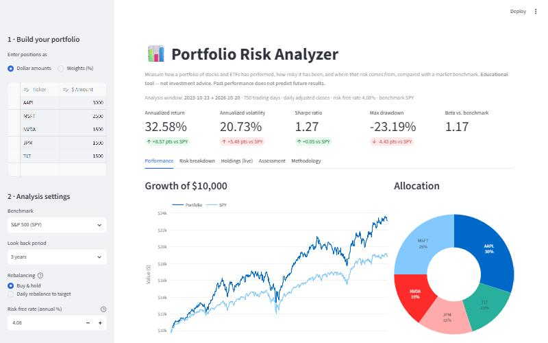
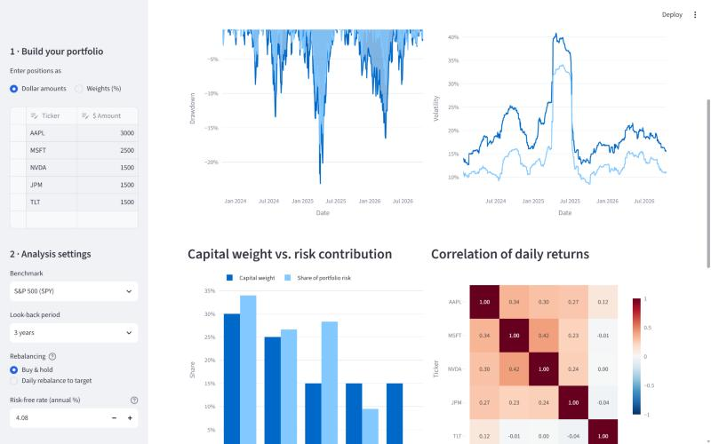
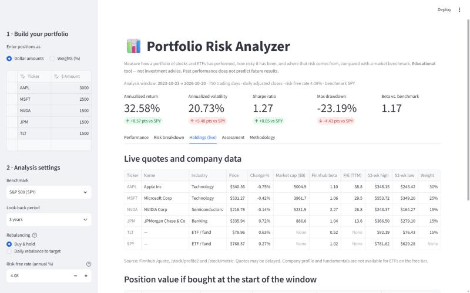
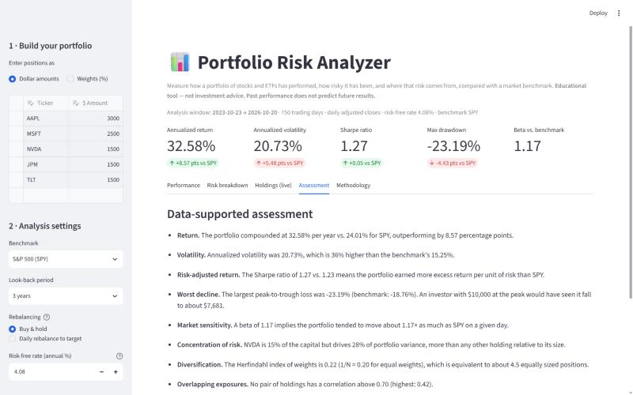

# 📊 Portfolio Risk Analyzer

An interactive Streamlit app that measures how a portfolio of stocks and ETFs has performed, **how risky it has been, and where that risk comes from**, compared with a market benchmark.

> **Assignment:** Project 2, Investment Portfolio Risk Analyzer (Finance/FinTech prototype built with an AI coding agent)
> **Educational tool. Not investment advice.**



---

## The financial problem

Investors often judge a portfolio by its return alone and underestimate (a) how volatile it is, (b) how much it can fall from a peak, and (c) how much of the risk comes from just one or two holdings. Two positions with the same dollar size can contribute very different amounts of risk. This app makes those things visible, so an investor can see how changing allocations changes the risk/return trade-off.

## Features

| Requirement | How the app meets it |
|---|---|
| Select ≥ 3 stocks/ETFs | Editable table in the sidebar; add or remove any number of rows |
| Enter amounts or weights | Toggle between **dollar amounts** and **weights (%)**; weights are rescaled automatically |
| Portfolio returns | Daily portfolio returns with **buy & hold** (drifting weights) or **daily rebalancing** |
| Annualized volatility, Sharpe, max drawdown | Shown as headline KPIs, plus Sortino, beta, tracking error, and 95% historical VaR |
| Allocation & performance charts | Allocation donut, growth of $10,000, drawdown, rolling volatility, risk contribution, correlation heatmap, risk/return scatter |
| Benchmark comparison | Choose SPY, QQQ, VTI, ACWI, or AOR (60/40). Every metric is shown side by side with deltas |
| Live market data | Finnhub quotes, company profiles, beta, P/E, and 52-week range for each holding |
| Interpretation | Rule-based "Assessment" tab that explains the numbers in plain English |
| Error handling | Invalid or unknown tickers, < 3 positions, negative amounts, duplicates, short histories, missing API key, API errors and rate limits are all handled without crashing |

## Quick start

Requires **Python 3.10+**.

```bash
git clone https://github.com/lavallieconnor-coder/portfolio-risk-analyzer.git
cd portfolio-risk-analyzer
python -m venv .venv
# Windows: .venv\Scripts\activate    macOS/Linux: source .venv/bin/activate
pip install -r requirements.txt
```

**Add your Finnhub key** (free at <https://finnhub.io/register>):

```bash
cp .env.example .env      # Windows: copy .env.example .env
# then edit .env and set FINNHUB_API_KEY=...
```

The key is optional. Without one, everything except the "Holdings (live)" tab still works, and you can also paste a key into the sidebar at runtime. `.env` is listed in `.gitignore`, so it is never committed.

**Run the app:**

```bash
streamlit run app.py
```

It opens at <http://localhost:8501>.

**Run the tests:**

```bash
pytest                    # all tests (some call the live APIs)
pytest -m "not network"   # offline-only tests
```

## How to use it

1. **Build a portfolio** in the sidebar. Edit tickers and amounts, or switch to weights.
2. Pick a **benchmark**, **look-back period** (1/3/5/10 years or custom), and **rebalancing** method.
3. The **risk-free rate** is pre-filled from the 13-week T-bill yield; you can override it.
4. Explore the tabs:
   - **Performance:** growth of $10,000, allocation, portfolio vs. benchmark table, per-asset stats
   - **Risk breakdown:** drawdowns, rolling volatility, risk contribution vs. capital weight, correlations, risk/return scatter
   - **Holdings (live):** Finnhub quotes and fundamentals, plus the current value of each position
   - **Assessment:** plain-English, data-driven interpretation
   - **Methodology:** formulas and limitations

Try this: set NVDA to 40% and watch volatility, max drawdown, and NVDA's share of portfolio risk jump. Then add TLT or another bond ETF and watch the correlation and risk-contribution charts change.

## Data sources

| Source | Used for | Endpoint(s) | Access |
|---|---|---|---|
| [Finnhub](https://finnhub.io/docs/api) | Live quote, company profile, fundamental metrics (beta, P/E, 52-week high/low) | `/quote`, `/stock/profile2`, `/stock/metric?metric=all` | Free tier (60 calls/min), API key required |
| [Yahoo Finance](https://finance.yahoo.com) via [`yfinance`](https://github.com/ranaroussi/yfinance) | Daily split- and dividend-adjusted closing prices | `yf.download` | Free, no key |
| Yahoo Finance `^IRX` | 13-week US T-bill yield, used as the risk-free rate | `yf.Ticker("^IRX")` | Free, no key |

**Why two sources?** Finnhub's historical candle endpoint (`/stock/candle`) is **not included in the free plan**. We confirmed it returns `"You don't have access to this resource."` with a free key. Historical prices therefore come from Yahoo Finance, the "permitted free historical-price source" option in the assignment. Finnhub provides the live and company-level data.

## Financial concepts and calculations

All calculations live in [`portfolio_risk/analytics.py`](portfolio_risk/analytics.py) and are unit-tested in [`tests/test_analytics.py`](tests/test_analytics.py). *r* = daily simple return; 252 trading days per year.

| Metric | Formula | What it tells an investor |
|---|---|---|
| Daily return | Pₜ / Pₜ₋₁ − 1 | Building block for everything else |
| Portfolio return | Buy & hold: value-weighted with drifting weights. Rebalanced: Σ wᵢ rᵢ | How the combined holdings performed |
| Total return | Π(1 + r) − 1 | Cumulative gain over the window |
| Annualized return (CAGR) | (1 + total)^(252/N) − 1 | Comparable yearly growth rate |
| Annualized volatility | σ(r) × √252 | Typical size of yearly fluctuations |
| Sharpe ratio | mean(r − r_f) / σ(r − r_f) × √252 | Excess return earned per unit of total risk |
| Sortino ratio | mean(r − r_f) / downside deviation × √252 | Like Sharpe, but only penalizes losses |
| Maximum drawdown | min(Wₜ / max₍ₛ≤ₜ₎ Wₛ − 1) | Worst peak-to-trough loss an investor would have lived through |
| Beta | cov(r_p, r_m) / var(r_m) | Sensitivity to market moves |
| Tracking error | σ(r_p − r_m) × √252 | How differently the portfolio behaves from the benchmark |
| Historical VaR (95%, 1-day) | −5th percentile of r | A "bad day" loss threshold |
| Risk contribution | wᵢ (Σw)ᵢ / (wᵀΣw) | Share of portfolio variance caused by each holding |
| Herfindahl index | Σ wᵢ² (effective N = 1/HHI) | Concentration of capital |
| Correlation matrix | corr(rᵢ, rⱼ) | Which holdings actually diversify each other |

**Verification.** Besides the hand-computed unit tests, the app's SPY figures for the default 3-year window (CAGR 24.01%, volatility 15.25%, max drawdown −18.76%) were cross-checked against an independent calculation done directly on downloaded prices, and they matched.

## Project structure

```
├── app.py                        # Streamlit UI
├── portfolio_risk/
│   ├── analytics.py              # Pure financial calculations
│   ├── data.py                   # Finnhub + Yahoo Finance access, error handling
│   └── validation.py             # Cleans/validates user-entered positions
├── tests/
│   ├── test_analytics.py         # Calculation tests against hand-computed values
│   └── test_validation_and_data.py  # Input validation + API error handling
├── docs/screenshots/
├── .env.example                  # Template for your API key
├── .streamlit/config.toml
├── requirements.txt
└── pytest.ini
```

## Screenshots

| Risk breakdown | Live holdings (Finnhub) |
|---|---|
|  |  |

**Assessment tab**



## How the AI coding agent was used

This project was built with **Claude Code** (Anthropic's AI coding agent) in an iterative loop:

1. **Scoping.** The agent was given the assignment brief, and Project 2 was chosen. Python + Streamlit was picked for reproducibility.
2. **Checking the data.** Before writing app code, the agent tested the Finnhub key against each endpoint and found that `/stock/candle` is blocked on the free tier. That led to the Finnhub + Yahoo Finance design.
3. **Building.** The agent wrote the calculation module first as pure functions, then the data layer, then the UI.
4. **Testing and fixing bugs.** Unit tests caught a real edge case: floating-point noise made a zero-volatility series produce a Sharpe ratio of about 7×10¹⁶ instead of "n/a". Running the app in a browser exposed two more bugs: Streamlit rendered `$10,000 … $7,681` as LaTeX math and dropped the dollar signs, and the risk-concentration note flagged the asset with the largest risk share rather than the one whose risk most exceeded its weight. All three were fixed.
5. **Refactoring for testability.** Input validation was moved out of the UI into `validation.py`, so the error-handling rules could be unit-tested.
6. **Verification.** Headline metrics were cross-checked against an independent calculation.

The student reviewed the code, chose the project and features, and is responsible for explaining the financial methodology.

## Known limitations

- **Backward-looking.** Every statistic describes the chosen historical window. Results change, sometimes a lot, with the start and end dates, and they do not predict future performance.
- **Normal-ish assumptions.** Volatility, Sharpe, and VaR summarize the past distribution. Real tail losses can be larger than history suggests.
- **No costs or taxes.** Transaction costs, bid/ask spreads, taxes, and cash drag are ignored. The daily-rebalancing option is theoretical and would be expensive in practice.
- **Long-only.** Short positions and leverage are not supported.
- **Common history only.** Dates are restricted to days when *all* assets traded, so one recently listed ticker shortens the whole analysis.
- **Data sources.** Yahoo Finance is an unofficial API and can be rate-limited or change without notice. Finnhub quotes may be delayed, and ETF profiles/fundamentals are not on the free tier (shown as "—").
- **Single risk-free rate.** The current T-bill yield is applied to the whole window rather than the historical rate for each day.
- **Not implemented:** efficient-frontier optimization, Monte Carlo projections, and non-USD currencies.

## Security note

No API keys are stored in this repository. Your key lives only in a local `.env` file, which `.gitignore` excludes.
